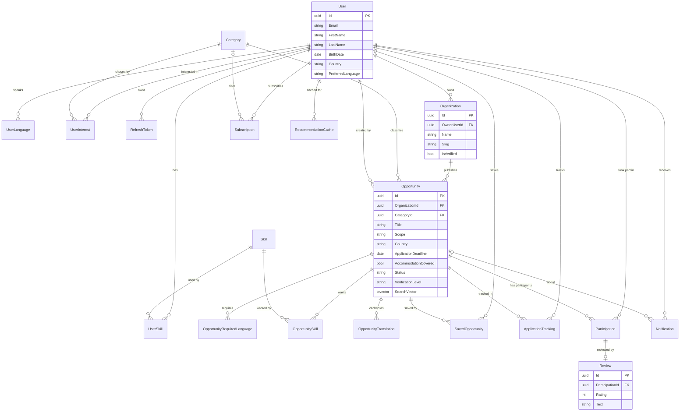

# Data model

Database: PostgreSQL via EF Core ([ADR 0001](adr/0001-postgresql.md)).
This is the plan the migrations will implement. It is a design document: the
diagram shows the main columns, the tables below list everything.

## Conventions

- Primary keys are `uuid` (`Guid`), except pure junction tables, which use a
  composite key.
- Timestamps are `timestamptz`, always UTC. Dates without a time of day (deadline,
  start, end) are `date`.
- Enums are stored as readable text (`HasConversion<string>`), not numbers.
- Countries are ISO 3166-1 alpha-2 codes (`AZ`, `DE`); country names come from the
  frontend (`Intl.DisplayNames`), so there is no Country table.
- Content (title, description) is stored in one language with an
  `OriginalLanguage` marker ([ADR 0003](adr/0003-single-language-content.md)).
  Categories and skills are small fixed taxonomies, so their names are three
  columns (AZ / EN / RU) instead of translation tables.
- Nothing important is hard-deleted: opportunities are archived, not removed.

## Diagram



## Entities

### Accounts

| Entity | Purpose | Key columns |
|---|---|---|
| `User` (ASP.NET Identity) | A person: volunteer, organizer or admin. Role is an Identity role. | `Email`, `FirstName`, `LastName`, `BirthDate`, `Country`, `City`, `Bio`, `AvatarUrl`, `PreferredLanguage`, `CreatedAt` |
| `RefreshToken` | Long-lived login, stored hashed, rotated on use | `UserId`, `TokenHash`, `ExpiresAt`, `RevokedAt`, `ReplacedByTokenHash` |
| `Skill` | Taxonomy of skills | `Slug` (unique), `NameAz`, `NameEn`, `NameRu` |
| `UserSkill` | User ↔ skill | PK (`UserId`, `SkillId`) |
| `UserLanguage` | Languages a user speaks | PK (`UserId`, `LanguageCode`), `Level` (A1–C2 or Native) |
| `UserInterest` | Categories a user cares about | PK (`UserId`, `CategoryId`) |

### Catalog

| Entity | Purpose | Key columns |
|---|---|---|
| `Category` | Taxonomy (environment, education, culture, social, events…) | `Slug` (unique), `NameAz`, `NameEn`, `NameRu` |
| `Organization` | Who runs the opportunities | `Name`, `Slug` (unique), `Description`, `LogoUrl`, `WebsiteUrl`, `Country`, `ContactEmail`, `IsVerified`, `OwnerUserId` |
| `Opportunity` | The central entity (see below) | |
| `OpportunityRequiredLanguage` | Languages needed | PK (`OpportunityId`, `LanguageCode`), `MinLevel` |
| `OpportunitySkill` | Skills that help | PK (`OpportunityId`, `SkillId`) |
| `OpportunityTranslation` | Cached AI translation | `OpportunityId`, `LanguageCode`, `Title`, `Description`, `SourceHash`, `Model`, `TranslatedAt` |

**`Opportunity` columns**

| Group | Columns |
|---|---|
| Identity | `Id`, `OrganizationId`, `CategoryId`, `CreatedByUserId` |
| Content | `Title`, `Description`, `OriginalLanguage` (`az`/`en`/`ru`) |
| Where | `Scope` (`Local`/`International`), `Country`, `City`, `IsOnline` |
| When | `StartDate`, `EndDate`, `ApplicationDeadline` (null = rolling), `DurationDays` |
| Who | `MinAge`, `MaxAge` |
| Covered costs | `AccommodationCovered`, `MealsCovered`, `TravelCovered`, `ParticipationFee`, `Currency` |
| How to apply | `ApplyUrl` (official page; applications are not taken inside Opportune) |
| Trust | `VerificationLevel` (`External`/`Verified`), `LastVerifiedAt`, `SourceUrl` |
| Origin | `Source` (`Manual`/`Import`/`Organizer`), `ExternalId` |
| Lifecycle | `Status`, `RejectionReason`, `PublishedAt`, `CreatedAt`, `UpdatedAt` |
| Search | `SearchVector` (generated `tsvector`) |

### User activity

| Entity | Purpose | Key columns |
|---|---|---|
| `SavedOpportunity` | Favorites | PK (`UserId`, `OpportunityId`), `SavedAt` |
| `ApplicationTracking` | The user's own application tracker | `UserId`, `OpportunityId`, `Status`, `Notes`, `AppliedAt`, `UpdatedAt` |
| `Participation` | "I took part in this" | `UserId`, `OpportunityId`, `StartDate`, `EndDate`, `CertificateUrl` |
| `Review` | Rating and text, only by someone with a participation | `ParticipationId` (unique), `Rating` (1–5), `Text`, `IsHidden`, `CreatedAt`, `UpdatedAt` |
| `Subscription` | Alert for a category and/or country | `UserId`, `CategoryId`, `Country` |
| `Notification` | In-app notification | `UserId`, `Type`, `Title`, `Message`, `OpportunityId`, `IsRead`, `CreatedAt` |
| `RecommendationCache` | Cached AI result | `UserId`, `ProfileHash`, `ResultJson` (`jsonb`), `CreatedAt`, `ExpiresAt` |

## Enums

| Enum | Values |
|---|---|
| `OpportunityStatus` | `Draft`, `PendingReview`, `Published`, `Archived`, `Expired` |
| `OpportunityScope` | `Local`, `International` |
| `VerificationLevel` | `External`, `Verified` |
| `OpportunitySource` | `Manual`, `Import`, `Organizer` |
| `TrackingStatus` | `Planned`, `Applied`, `Accepted`, `Rejected`, `Withdrawn` |
| `LanguageLevel` | `A1`, `A2`, `B1`, `B2`, `C1`, `C2`, `Native` |
| `NotificationType` | `DeadlineReminder`, `NewMatchingOpportunity`, `OpportunityApproved`, `OpportunityRejected` |

**Opportunity lifecycle**

```
Draft ──► PendingReview ──► Published ──► Archived
              │                │
              └─► Draft        └──► Expired   (deadline or end date passed,
          (rejected, with           set by a background job)
           a reason)
```

## Constraints and indexes

| Rule | How |
|---|---|
| One tracker entry per user and opportunity | unique (`UserId`, `OpportunityId`) on `ApplicationTracking` |
| One participation per user and opportunity | unique (`UserId`, `OpportunityId`) on `Participation` |
| One review per participation | unique `ParticipationId` on `Review` |
| Rating is 1 to 5 | check constraint on `Review.Rating` |
| Age range makes sense | check `MinAge <= MaxAge` |
| End after start | check `EndDate >= StartDate` |
| Paid projects state a currency | check: `ParticipationFee = 0` or `Currency` is set |
| No duplicate imports | unique (`Source`, `ExternalId`) where `ExternalId` is not null |
| One translation per language | unique (`OpportunityId`, `LanguageCode`) |
| A subscription filters something | check: `CategoryId` or `Country` is set; unique with `NULLS NOT DISTINCT` |
| Catalog queries are fast | indexes on (`Status`, `ApplicationDeadline`), `Country`, `CategoryId`, `Scope`, and a GIN index on `SearchVector` |
| Notification list is fast | index (`UserId`, `IsRead`, `CreatedAt` desc) |
| Unique slugs | unique `Slug` on `Category`, `Skill`, `Organization` |

## Delete behavior

| Relationship | Behavior | Why |
|---|---|---|
| `User` → `RefreshToken`, `SavedOpportunity`, `ApplicationTracking`, `Notification`, `Subscription`, `RecommendationCache`, `UserSkill`, `UserLanguage`, `UserInterest` | Cascade | Personal data goes with the account |
| `Opportunity` → `OpportunityRequiredLanguage`, `OpportunitySkill`, `OpportunityTranslation` | Cascade | Owned by the opportunity |
| `Opportunity` → `SavedOpportunity`, `ApplicationTracking` | Cascade | Meaningless without it |
| `Opportunity` → `Participation` | Restrict | Participation history and reviews must not vanish; archive instead |
| `Participation` → `Review` | Cascade | A review belongs to its participation |
| `Organization` → `Opportunity` | Restrict | An organization with opportunities cannot be deleted; archive them first |
| `Category` → `Opportunity` | Restrict | Prevents orphaned classification |
| `User` → `Organization`, `Opportunity` (as creator) | Restrict | Prevents losing content when a user leaves |
| `Opportunity` → `Notification` | Set null | The notification text remains readable |

## Open decisions

- **One owner or a team per organization?** The first version uses a single
  `OwnerUserId`. A later `OrganizationMember` table would allow several
  coordinators.
- **Starting lists** for categories and skills (seeded by a migration).
- **Review visibility:** hidden reviews (`IsHidden`) are moderated by an admin.
